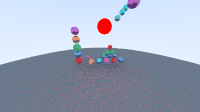
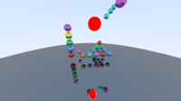

Here are some completed projects I have done over the last few years:

# Reports
- Geometric optimization for designing modular cycling tracks from recycled curved panels [(link to the report)](Reports/PierreBodetReportInternship.pdf)
- Multi-robot coordination and strategy optimisation in a maze using genetic algorithms [(link to the report)](Reports/Rapport%20TIPE%20Pierre%20BODET.pdf)

# 1. Sign Language Alphabet Recognition

- Recognition of the Esperanto Sign Language Alphabet, implemented in LabVIEW, with an error correction feature. [(link to the directory)](Alphabet%20Recognition%20Using%20Sign%20Language)

# 2. 3D Ray Tracing engine in Python with physical simulation

# 3. Python
- Website serving as a database of films watched, automatically downloading pictures from the films and allowing users to see which other films the actors have starred in. [(link to the file)](Base_de_donnée_films/app.py)
- Discord bot that adds a personalised schedule based on members, adds a birthday message... [(link to the file)](Bots_discord/bot_principal_emploi_du_temps.py)
- Discord bot that calculates rankings by asking students for their marks and adds CCINP exercises [(link to the file)](Bots_discord/bot_exercices_ccinp_et_classement.py)

# 4. Javascript
- Website allowing users to play the board game "Poule Poule" in multiplayer mode across the world. [(link to the file)](Jeu_Poule_Poule_site/server.js)

# 5. Brainfuck
- Code for playing tic-tac-toe against a skilled robot [(link to the file)](Brainfuck/morpion_robot.bf)
- Programme that generates QR codes by providing it with the wanted link [(link to the file)](Brainfuck/QR_code.bf)
